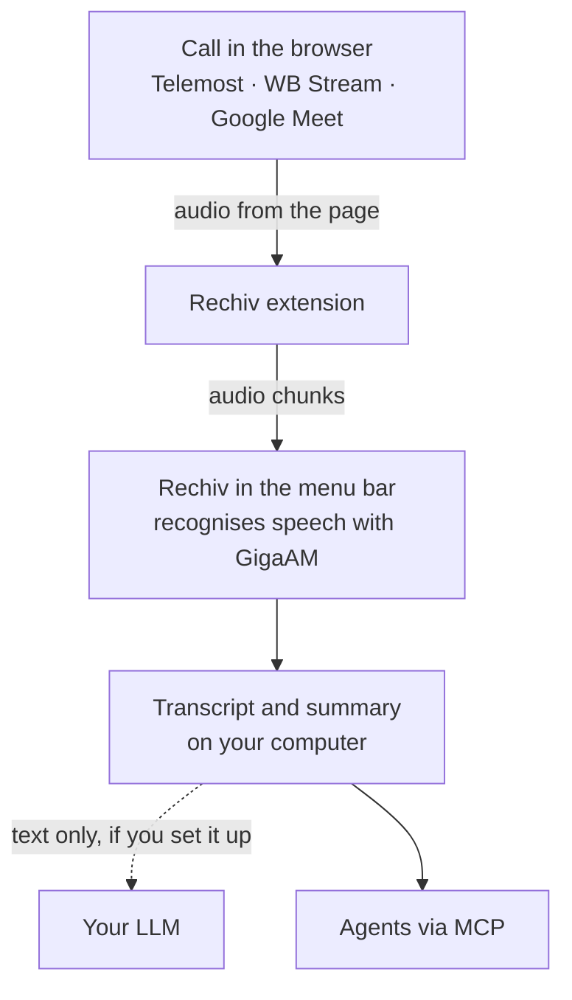

**English** · [Русский](README.ru.md)

<p align="center">
  
</p>

<h1 align="center">Rechiv</h1>

<p align="center">Records and transcribes online calls right on your computer</p>

<p align="center">
  <a href="https://github.com/zaitsev-av/rechiv/releases"><b>Download for macOS (Apple Silicon)</b></a>
</p>

<p align="center">
  <a href="https://github.com/zaitsev-av/rechiv/releases"></a>
  <a href="https://github.com/zaitsev-av/rechiv/actions/workflows/ci.yml"></a>
  <a href="LICENSE"></a>
  
</p>

<picture>
  <source media="(prefers-color-scheme: dark)" srcset="docs/images/transcript-dark.png">
  
</picture>

Rechiv records, transcribes and analyses online calls locally on macOS and Linux.
The app lives in the menu bar, a browser extension captures the call audio, and speech
is recognised on your computer by the GigaAM model.

Supported platforms are Yandex Telemost (`telemost.yandex.ru`), WB Stream
(`stream.wb.ru`) and Google Meet (`meet.google.com`).

<table>
  <tr>
    <td width="50%">
<picture>
  <source media="(prefers-color-scheme: dark)" srcset="docs/images/history-dark.png">
  
</picture>
    </td>
    <td width="50%">
<picture>
  <source media="(prefers-color-scheme: dark)" srcset="docs/images/summary-dark.png">
  
</picture>
    </td>
  </tr>
</table>

## Features

- a menu bar app: recording status, start and stop recording of the open call;
- speaker name for every line: from separate streams or from the platform's signalling;
- live transcript during the call;
- a movable, resizable live panel on top of the page;
- call history with virtual folders, call-link rules and retention;
- transcript editing and export;
- summaries via a configurable OpenAI-compatible LLM API: on demand or automatically
  for a folder, with manual editing; generation continues even if you close the page;
- call titles from a folder template, with a topic from the LLM;
- an MCP server so agents can read recordings;
- light and dark themes, three palettes;
- recovery of unfinished jobs after a restart.

## Installation

A ready build for macOS on Apple Silicon is in
[Releases](https://github.com/zaitsev-av/rechiv/releases): download
`Rechiv-<version>-arm64.dmg` and drag `Rechiv.app` to Applications. A `.sha256` file
next to it lets you verify the download.

The app is signed without a Developer ID, so on first launch macOS warns that it cannot
verify the developer. Open it via the context menu → “Open” or allow it in
“System Settings → Privacy & Security”.

On first launch Rechiv shows how to connect the extension: it lives in the app's data
folder and is loaded into the browser as an unpacked extension in developer mode.
Chrome, Edge, Brave, Vivaldi and other Chromium browsers work. For summaries, set the
address, model and token of an OpenAI-compatible LLM in the settings.

<picture>
  <source media="(prefers-color-scheme: dark)" srcset="docs/images/onboarding-dark.png">
  
</picture>

## Usage

1. Open a call in Telemost, WB Stream or Google Meet.
2. Start recording from the Rechiv menu bar item (“Start recording” appears while the call tab
   is open) or from the extension popup. A folder with a call-link rule can also start
   recording automatically.
3. Open the movable live panel if you need it — from the menu bar item or the popup.
4. Stop the recording after the call.
5. Open the transcript from the menu bar item or the “Sessions” page served by the desktop app;
   the extension's own links redirect there.

The extension closes an audio chunk on a pause in speech; 20 seconds is only a safety
cap for an uninterrupted monologue. That is why the first live line appears soon after
the speaker pauses.

Chunks in which a participant stayed silent are not sent for recognition, and the
GigaAM model is loaded as soon as recording starts, so it is ready for the first chunk.

### Folders

Calls can be organized into virtual folders without moving files on disk. In a call’s ⋯ menu, move it to a folder and enable a rule for its call link. The rule applies to new calls; a dialog offers to move matching past calls. Deleting a folder returns its calls to Inbox.

Folder settings (⋯ in the folder header) offer a title template with `{date}`, `{time}` and `{weekday}` in the machine’s local time, retention in days, and a “Record automatically” switch that starts recording when you join a call by the folder's link. The template applies to new calls routed by a link rule and, after confirmation, to existing automatic titles; manual titles and manual moves are preserved. Optional retention deletes calls older than the selected number of days at startup, hourly and immediately after saving, excluding recording and processing calls.

With an LLM connected, `{topic}` adds a short Russian call topic after the transcript is ready; until then, the title omits the topic and its separators. Folder settings can also enable automatic summaries. The desktop app makes one attempt after the transcript is ready, preserves existing summaries (including manual edits), resumes unfinished processing after a restart, and the extension reports the result in the ready notification; summaries can still be generated manually on the transcript page. Without a connected LLM the topic chip and summary toggle are disabled, while saved folder values are preserved.

## How it works



The extension records audio straight from the call page; no bot joins the call. Speaker
names come from the platform itself, and the GigaAM model recognises speech on your computer.

## Privacy

- Audio is recorded and recognised on your computer; nothing goes to an external speech
  recognition service.
- Recordings live in `~/Library/Application Support/Rechiv` (`~/.rechiv` on Linux).
- Only the transcript text leaves the computer, and only to the LLM you configured — when a
  summary or a call topic is generated. The LLM token is kept in the macOS Keychain.
- The app listens on `127.0.0.1` only, and its API is protected by a local token.
- Connecting MCP gives an agent access to your recordings; it sends what it reads to its LLM.
- Tell participants that the call is recorded: rules depend on the country and company.

## MCP: connecting an agent

The server reads local recordings over stdio and works without the application running.
Connecting it in Claude Code:

```bash
claude mcp add rechiv -- "/Applications/Rechiv.app/Contents/MacOS/rechiv" mcp
```

For another location, pass the path to the binary. The recordings directory can be set
with `mcp -data-dir /path/to/data`; by default the application's directory is used.

The `folder` filter matches part of a folder name (case-insensitive, ё/е equivalent);
`inbox` or `Входящие` selects calls without a folder. List results include the folder name
as `folder`.

- `rechiv_list_calls` — find a call by date, title, participant or `folder`;
- `rechiv_get_summary` — read the summary on its own;
- `rechiv_get_transcript` — get a fragment by `HH:MM:SS` timestamps or
  `offset`/`limit` (up to 200 segments, continue with `next_offset`);
- `rechiv_search` — find text ignoring case and ё/е; every match contains the call's
  ID, title and date, the timestamp, the speaker, the text and the segment index.

MCP only reads recordings. By adding the server to an agent's config you give the agent
access to summaries and transcripts: the agent sends what it reads to its LLM, including
an external provider.

## Limitations

- only Chromium browsers (Manifest V3) are supported; the extension is installed unpacked
  in developer mode;
- participant names depend on the platform's DOM and signalling; in Telemost all other
  participants arrive as one audio stream and the speaker is determined from signalling;
- in Google Meet the extension decodes the other participants' audio frames itself and
  splits them by source; calls with five or more participants have not been tested yet;
- a ready build exists only for macOS on Apple Silicon; it is signed without a Developer ID
  and not notarized; there are no automatic updates yet — download new versions from Releases;
- on Linux only the binary is built; `.deb`, `.rpm` and AppImage packages are not;
- summaries require access to an external LLM API.

## FAQ

**macOS refuses to open the app: “cannot verify the developer”.**
The build is signed without a Developer ID. Open `Rechiv.app` via the context menu → “Open”
or allow it in “System Settings → Privacy & Security”. If that does not help:
`xattr -dr com.apple.quarantine /Applications/Rechiv.app`.

**The Rechiv menu has no “Start recording”.**
The item appears while a call tab is open and the extension is connected. Check that the
extension is enabled on the browser's extensions page and reload the call tab.

**After a Rechiv update the extension asks to be updated.**
Click ↻ on Rechiv on the browser's extensions page and reload the call tab.

**A line in Telemost says “Unknown participant”.**
Telemost delivers all other participants as one audio stream, and Rechiv finds the speaker
from the platform's signalling. When two people talk at once, no name is set, so that the
line is not attributed to the wrong person.

**The summary button is disabled.**
Set the address, model and token of an OpenAI-compatible LLM in the settings; the “Check”
button shows whether the model responds.

## Development

```bash
task setup
task model
task run
```

Requirements, building the `.app` and releases, architecture, API and repository layout are in
[docs/development.md](docs/development.md).

## Documentation

- [Development](docs/development.md): building, releases, architecture, API.
- [Desktop app](desktop/README.md): the queue, the engine and the Python protocol.
- [CONTRIBUTING.md](CONTRIBUTING.md): how to contribute; documentation is kept in two languages.

## License

[MIT](LICENSE).

The summary editor uses [Tiptap](https://github.com/ueberdosis/tiptap) (MIT), including its official Markdown extension.
