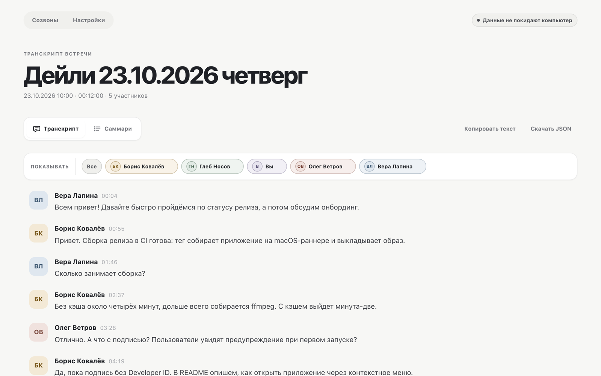
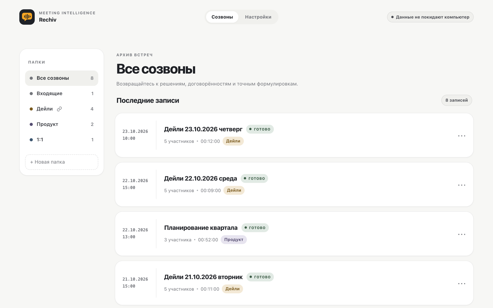
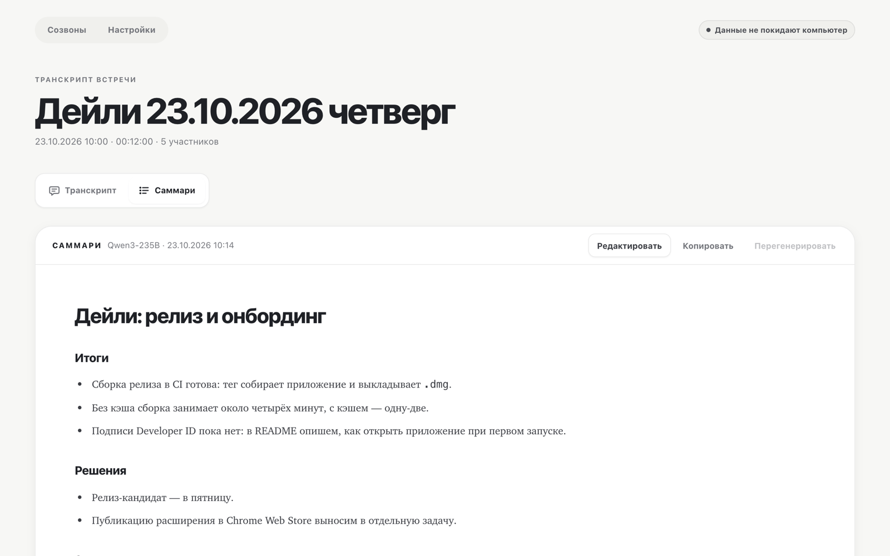
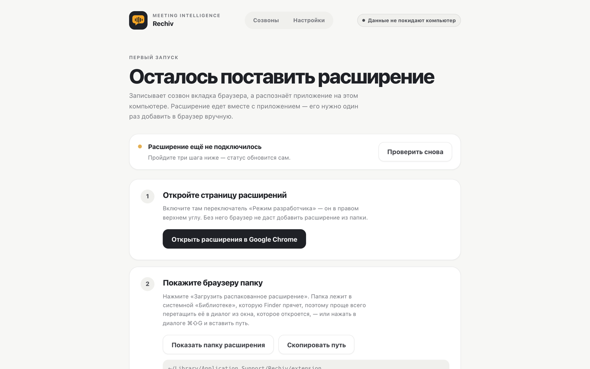
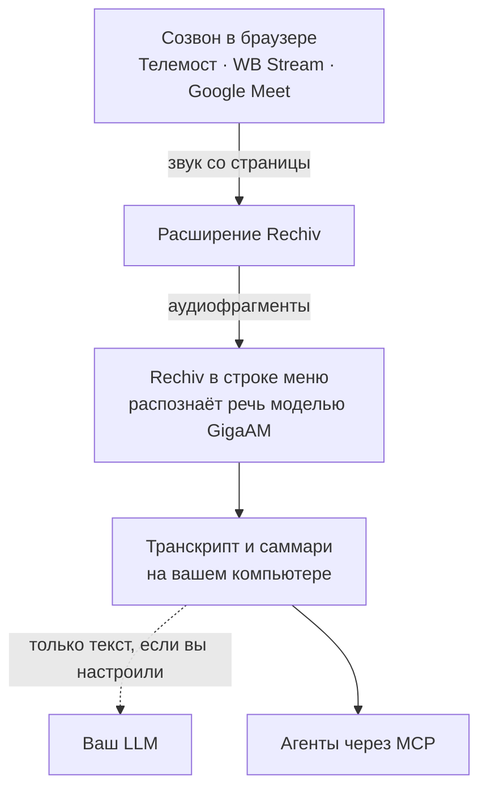

[English](README.md) · **Русский**

<p align="center">
  
</p>

<h1 align="center">Rechiv</h1>

<p align="center">Записывает и расшифровывает онлайн-созвоны прямо на вашем компьютере</p>

<p align="center">
  <a href="https://github.com/zaitsev-av/rechiv/releases"><b>Скачать для macOS (Apple Silicon)</b></a>
</p>

<p align="center">
  <a href="https://github.com/zaitsev-av/rechiv/releases"></a>
  <a href="https://github.com/zaitsev-av/rechiv/actions/workflows/ci.yml"></a>
  <a href="LICENSE"></a>
  
</p>

<picture>
  <source media="(prefers-color-scheme: dark)" srcset="docs/images/transcript-dark.png">
  
</picture>

Rechiv — локальная запись, транскрибация и анализ онлайн-созвонов для macOS и Linux.
Приложение живёт в строке меню, расширение браузера записывает звук созвона, а речь
распознаётся на компьютере моделью GigaAM.

Поддерживаются созвоны в Яндекс Телемосте (`telemost.yandex.ru`), WB Stream
(`stream.wb.ru`) и Google Meet (`meet.google.com`).

<table>
  <tr>
    <td width="50%">
<picture>
  <source media="(prefers-color-scheme: dark)" srcset="docs/images/history-dark.png">
  
</picture>
    </td>
    <td width="50%">
<picture>
  <source media="(prefers-color-scheme: dark)" srcset="docs/images/summary-dark.png">
  
</picture>
    </td>
  </tr>
</table>

## Возможности

- приложение в строке меню: состояние записи, старт и остановка записи открытого созвона;
- имя говорящего для каждой реплики: по отдельным потокам или по сигналингу площадки;
- live-транскрипт во время созвона;
- перемещаемая и изменяемая live-панель поверх страницы;
- история созвонов с виртуальными папками, правилами по ссылке встречи и сроком хранения;
- редактирование и экспорт транскрипта;
- саммари через настраиваемый OpenAI-совместимый LLM API: вручную или автоматически
  для папки, с ручной правкой; генерация продолжается, даже если закрыть страницу;
- названия созвонов по шаблону папки, с темой от LLM;
- MCP-сервер, чтобы агенты читали записи;
- светлая и тёмная темы, три палитры;
- восстановление незавершённых задач после перезапуска.

## Установка

Готовая сборка для macOS на Apple Silicon лежит в
[Releases](https://github.com/zaitsev-av/rechiv/releases): скачайте
`Rechiv-<версия>-arm64.dmg` и перетащите `Rechiv.app` в «Программы». Рядом лежит
`.sha256` для проверки файла.

Приложение подписано без Developer ID, поэтому при первом запуске macOS предупредит,
что не может проверить разработчика. Откройте его через контекстное меню → «Открыть»
или разрешите в «Системные настройки → Конфиденциальность и безопасность».

При первом запуске Rechiv покажет, как подключить расширение: оно лежит в папке данных
приложения и загружается в браузер как распакованное в режиме разработчика. Подходят
Chrome, Edge, Brave, Vivaldi и другие браузеры на Chromium. Для саммари укажите в
настройках адрес, модель и токен OpenAI-совместимого LLM.

<picture>
  <source media="(prefers-color-scheme: dark)" srcset="docs/images/onboarding-dark.png">
  
</picture>

## Использование

1. Откройте созвон в Телемосте, WB Stream или Google Meet.
2. Начните запись из меню Rechiv в строке меню («Начать запись» появляется, пока открыта вкладка
   созвона) или из попапа расширения. Папка с правилом по ссылке встречи может начинать
   запись и автоматически.
3. При необходимости откройте перемещаемую live-панель — из меню Rechiv или из попапа.
4. Завершите запись после звонка.
5. Откройте транскрипт из меню Rechiv или на странице «Созвоны», которую отдаёт desktop;
   ссылки расширения ведут туда же.

Расширение закрывает аудиофрагмент по паузе в речи, а 20 секунд остаются лишь
страховочным потолком для непрерывного монолога. Поэтому первая live-реплика
появляется вскоре после того, как говорящий сделает паузу.

Фрагменты, в которых участник молчал, на распознавание не отправляются, а модель
GigaAM загружается сразу при старте записи — к первому фрагменту она уже готова.

### Папки

Созвоны можно раскладывать по виртуальным папкам без перемещения файлов на диске. В меню ⋯ у созвона выберите папку и включите правило по ссылке: новые записи попадут туда автоматически, а прошлые можно перенести через диалог. При удалении папки её созвоны возвращаются во «Входящие».

В настройках папки (⋯ в её шапке) доступны шаблон названия с `{date}`, `{time}` и `{weekday}` по локальному времени компьютера и срок хранения в днях, а переключатель «Записывать автоматически» начинает запись при входе в созвон по ссылке папки. Шаблон действует на новые созвоны по правилу ссылки и, после подтверждения, на прошлые автоматические названия; ручные названия и названия при ручном переносе сохраняются. Хранение удаляет старые созвоны при запуске, каждый час и сразу после сохранения настроек, кроме записываемых и обрабатываемых.

При подключённом LLM подстановка `{topic}` добавляет короткую тему созвона на русском после готовности транскрипта; до этого тема и разделители вокруг неё не выводятся. В настройках папки можно включить автоматическое саммари. Desktop делает одну попытку после готовности транскрипта, сохраняет существующее саммари (включая ручные правки), доделывает прерванную обработку после перезапуска, а расширение сообщает результат в уведомлении о готовности; саммари можно сделать вручную на странице транскрипта. Без подключённого LLM чип темы и переключатель саммари неактивны, сохранённые настройки папки остаются.

## Как это устроено



Расширение пишет звук прямо со страницы созвона, бот в созвон не заходит. Имена
говорящих берутся из самой площадки, а речь распознаёт модель GigaAM на вашем компьютере.

## Приватность

- Звук записывается и распознаётся на вашем компьютере, во внешний сервис распознавания
  ничего не уходит.
- Записи лежат в `~/Library/Application Support/Rechiv` (на Linux — `~/.rechiv`).
- Наружу уходит только текст транскрипта и только в LLM, который вы сами указали, — когда
  делается саммари или тема созвона. Токен LLM хранится в Keychain macOS.
- Приложение слушает только `127.0.0.1`, его API закрыт локальным токеном.
- Подключая MCP, вы открываете агенту свои записи: прочитанное он отправляет своему LLM.
- Предупреждайте участников о записи: правила зависят от страны и компании.

## MCP: подключение агента

Сервер читает локальные записи через stdio и работает без запущенного приложения.
Подключение в Claude Code:

```bash
claude mcp add rechiv -- "/Applications/Rechiv.app/Contents/MacOS/rechiv" mcp
```

Для другого расположения укажите путь к бинарю. Каталог записей можно задать
через `mcp -data-dir /путь/к/данным`; по умолчанию используется каталог приложения.

Фильтр `folder` ищет подстроку имени папки без учёта регистра и ё/е; `inbox` или
`Входящие` выбирает созвоны без папки. В результатах списка поле `folder` содержит имя папки.

- `rechiv_list_calls` — найти созвон по дате, названию, участнику или папке (`folder`);
- `rechiv_get_summary` — прочитать саммари отдельно;
- `rechiv_get_transcript` — получить фрагмент по таймкодам `HH:MM:SS` или
  `offset`/`limit` (до 200 сегментов, продолжение через `next_offset`);
- `rechiv_search` — найти текст без учёта регистра и ё/е; каждое совпадение содержит
  ID, название и дату созвона, таймкод, говорящего, текст и индекс сегмента.

MCP только читает записи. Добавляя сервер в конфиг агента, вы открываете ему доступ
к саммари и транскриптам: агент отправляет прочитанные фрагменты своей LLM,
в том числе внешнему провайдеру.

## Ограничения

- поддерживаются только браузеры на Chromium (Manifest V3); расширение ставится как
  распакованное в режиме разработчика;
- имена участников зависят от DOM и сигналинга площадки; в Телемосте все собеседники
  приходят одним аудиопотоком, и говорящий определяется по сигналингу;
- в Google Meet расширение само декодирует аудиокадры собеседников и разделяет их по
  источникам; созвоны на пять и более участников пока не проверялись;
- готовая сборка есть только для macOS на Apple Silicon; она подписана без Developer ID
  и не нотаризована; автообновления пока нет — новую версию скачивают из Releases;
- для Linux собирается только бинарник, пакеты `.deb`, `.rpm` и AppImage не собираются;
- для генерации саммари требуется доступ к внешнему LLM API.

## Вопросы

**macOS не открывает приложение: «не удаётся проверить разработчика».**
Сборка подписана без Developer ID. Откройте `Rechiv.app` через контекстное меню → «Открыть»
или разрешите в «Системные настройки → Конфиденциальность и безопасность». Если не помогло:
`xattr -dr com.apple.quarantine /Applications/Rechiv.app`.

**В меню Rechiv нет «Начать запись».**
Пункт появляется, пока открыта вкладка созвона и расширение подключено. Проверьте, что
расширение включено на странице расширений браузера, и обновите вкладку созвона.

**После обновления Rechiv расширение просит обновиться.**
Нажмите ↻ у Rechiv на странице расширений браузера и обновите вкладку созвона.

**В Телемосте у реплики «Неизвестный участник».**
Телемост отдаёт всех собеседников одним звуковым потоком, а говорящего Rechiv определяет
по сигналингу площадки. Когда два человека говорят одновременно, имя не ставится, чтобы
не приписать реплику не тому.

**Кнопка саммари неактивна.**
Укажите в настройках адрес, модель и токен OpenAI-совместимого LLM; кнопка «Проверить»
покажет, отвечает ли модель.

## Разработка

```bash
task setup
task model
task run
```

Требования, сборка `.app` и релизы, архитектура, API и структура репозитория —
в [docs/development.ru.md](docs/development.ru.md).

## Документация

- [Разработка](docs/development.ru.md): сборка, релизы, архитектура, API.
- [Desktop-приложение](desktop/README.ru.md): очередь, движок и протокол с Python.
- [CONTRIBUTING.md](CONTRIBUTING.md): правила изменений; документация ведётся на двух языках.

## Лицензия

[MIT](LICENSE).

Редактор саммари использует [Tiptap](https://github.com/ueberdosis/tiptap) (MIT), включая официальное расширение Markdown.
