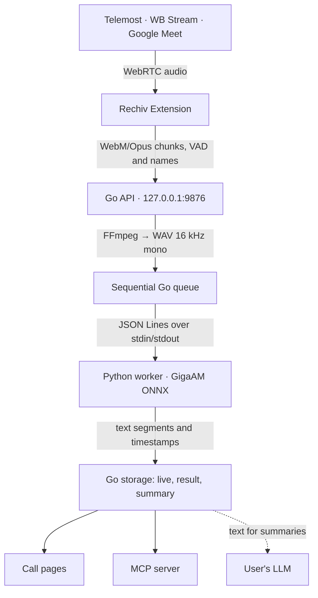

**English** · [Русский](development.ru.md)

# Developing Rechiv

Everything you need to build and change Rechiv. The user guide is in the [README](../README.md).

## Development requirements

- macOS on Apple Silicon or a modern Linux x86-64/ARM64;
- Go — the version from `desktop/go.mod` (currently 1.27.0);
- Python 3.10–3.13;
- Node.js 22+;
- [Task](https://taskfile.dev/);
- FFmpeg;
- a Chromium browser.

The app ships with the GigaAM model and needs no network for recognition. For development, build
the model once with `task model`: it downloads the GigaAM weights, exports them to ONNX and
quantizes them to int8 in `build/onnx-int8`.

## Development

Run all commands from the repository root:

```bash
task doctor
task setup
task run
```

`task setup` creates `service/.venv` and installs the extension dependencies.
`task run` starts the local Go application on `127.0.0.1:9876`. Its pages open at
`http://rechiv.localhost:9876/`: browsers resolve any `*.localhost` name to this computer.

To develop the extension and the Go application at the same time:

```bash
task dev
```

After the first build open `chrome://extensions`, enable developer mode and choose
“Load unpacked” → `extension/dist`.

## Building for Linux

Linux amd64 and the extension:

```bash
task setup
task build:linux
```

Output:

```text
build/rechiv-linux-amd64
extension/dist/
```

The binary finds the interpreter from `service/.venv` next to itself or higher up the
project tree. If the venv lives elsewhere, pass it explicitly:

```bash
build/rechiv-linux-amd64 -python /path/to/venv/bin/python
```

Engine readiness is visible right after start: `GET /health` returns an `engine`
field with the status `starting`, `ready` or `error` and the error reason.

For Linux ARM64:

```bash
task build:linux LINUX_ARCH=arm64
```

`task build` builds macOS arm64, Linux amd64 and the extension at once.

## Building Rechiv.app

`Rechiv.app` for macOS on Apple Silicon bundles the Python runtime, the model, ffmpeg, the web
interface and the extension:

```bash
task prefetch          # download sources from scripts/prefetch.lock, verifying sha256
task desktop:python-runtime
task desktop:ffmpeg
task desktop:app       # build/Rechiv.app
task desktop:package   # build/dist/Rechiv-<version>-arm64.dmg and .sha256
```

`task prefetch` takes the model from the `model-gigaam-v3-e2e-ctc-int8` release
(`MODEL_BASE_URL=https://github.com/zaitsev-av/rechiv/releases/download/model-gigaam-v3-e2e-ctc-int8`);
alternatively build it locally with `task model`.

The app version lives in `VERSION`; `task version` checks it against the extension, and
`task version:set -- 1.2.3` writes a new one to every file. A `v1.2.3` tag runs
`.github/workflows/release.yml`, which builds on a macOS runner and publishes a release with the
`.dmg`; a tag with a suffix (`v1.2.3-rc1`) creates a pre-release.

## Architecture



Go is responsible for the HTTP API, security, sessions, files, the queue, retries,
finalisation and recovery. Python only loads GigaAM and recognises a prepared WAV file.

Protocol details are in [`desktop/README.md`](../desktop/README.md).

## Local data and tokens

Data is stored in:

```text
macOS: ~/Library/Application Support/Rechiv
Linux: ~/.rechiv
```

The API listens on the loopback interface only. Every working endpoint is protected
by a local per-installation Bearer token that the extension obtains automatically.

For manual diagnostics:

```bash
task desktop:token

curl -H "Authorization: Bearer $(task --silent desktop:token)" \
  http://127.0.0.1:9876/sessions
```

The local application token is not an external LLM token. The LLM address, model and token
are set in the Rechiv settings and stored by the desktop application: the token goes to the
macOS Keychain (a file readable only by the owner on other systems), and the desktop app makes
all LLM requests itself. Settings saved by older extension versions are moved to the desktop app
once and erased from the browser.

## Main commands

```bash
task doctor          # check tools
task setup           # install Python and Node.js dependencies
task run             # run the application
task dev             # application + extension watch build
task test            # run all tests
task lint            # run code checks
task build           # build macOS, Linux and the extension
task build:macos     # build macOS arm64 and the extension
task build:linux     # build Linux amd64 and the extension
task prefetch        # download the .app build sources
task desktop:app     # build Rechiv.app
task desktop:package # package the .app into a .dmg
task docs:screenshots # take README screenshots
task version         # check the app and extension versions
task icons           # rebuild icons from SVG
task check           # lint + test + build
task clean           # remove builds and caches
task clean:all       # also remove .venv and node_modules
task --list          # list all commands
```

Run parameters can be overridden:

```bash
task run THREADS=8
task run ENGINE=torch DEVICE=mps   # GigaAM on torch instead of ONNX; needs torch in service/.venv
task setup PYTHON=python3.12
task run LISTEN=127.0.0.1:9876
task build:linux LINUX_ARCH=arm64
```

## Repository layout

```text
rechiv/
├── desktop/
│   ├── assets/                 # SVG, PNG and macOS iconset
│   ├── cmd/rechiv/             # the app and the mcp command
│   ├── engine/worker.py        # JSONL worker for GigaAM
│   └── internal/               # API, queue, storage, security
├── extension/
│   ├── src/background/         # service worker
│   ├── src/content/            # WebRTC capture, platform adapters, live panel
│   ├── src/pages/              # sessions, transcript, settings (served by desktop)
│   ├── src/popup/              # popup: status and recording
│   └── tests/
├── service/
│   ├── rechiv_engine/models/   # GigaAM on ONNX and torch, splitting by pauses
│   ├── tools/                  # model export to ONNX and quantization
│   ├── tests/
│   └── pyproject.toml
├── scripts/                    # runtime, ffmpeg, .app and .dmg builds, versioning
├── .github/workflows/
│   ├── ci.yml                  # extension and Go tests
│   └── release.yml             # .dmg release on a tag
├── docs/                       # developer docs and screenshots
├── VERSION
└── Taskfile.yml
```

## API

Main endpoints:

- `GET /health`, `GET /auth/token`;
- `POST /sessions`, `GET /sessions`, `GET|DELETE /sessions/{id}`;
- `POST /sessions/{id}/chunks`, `/speakers`, `/vad`, `/finish`, `/retry`;
- `PUT /sessions/{id}/title`, `/topic`, `/folder`;
- `GET /sessions/{id}/live`;
- `GET|PUT /sessions/{id}/transcript`;
- `GET|PUT /sessions/{id}/summary`, `POST /sessions/{id}/summary/generate`;
- `GET|POST /folders`, `PATCH|DELETE /folders/{id}`, `PUT /folders/{id}/settings`,
  folder rules, titles and retention;
- `GET|PUT /settings/llm`, `POST /settings/llm/check`, `GET|PUT /settings/appearance`;
- `GET /onboarding/state`;
- `POST /calls/poll`;
- `GET /events`.

## Documentation screenshots

Screenshots in `docs/images/` are taken from the real app on fictional data:

```bash
task docs:screenshots
```

`scripts/screenshots/run.sh` fills a temporary data directory with calls from
`scripts/screenshots/seed.py`, starts the app on port 9877 and captures the pages in the light
and dark themes with headless Chrome or Brave (`capture.mjs`, no dependencies). It needs the
built web UI, `service/.venv` and the model, as `task run` does. Refresh the screenshots for
releases rather than after every change: each set adds ~2 MB to the history.
