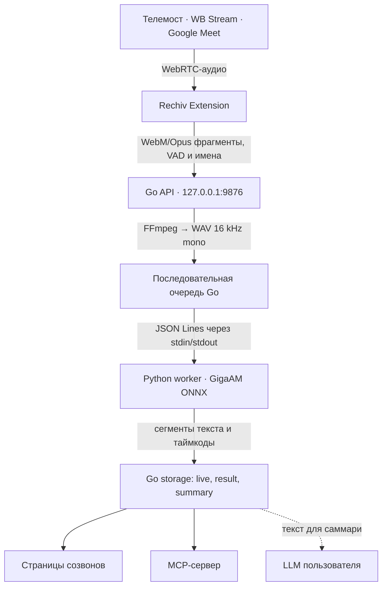

[English](development.md) · **Русский**

# Разработка Rechiv

Всё, что нужно, чтобы собрать и изменить Rechiv. Пользовательская часть — в [README](../README.ru.md).

## Требования для разработки

- macOS на Apple Silicon или современный Linux x86-64/ARM64;
- Go — версия из `desktop/go.mod` (сейчас 1.27.0);
- Python 3.10–3.13;
- Node.js 22+;
- [Task](https://taskfile.dev/);
- FFmpeg;
- браузер на Chromium.

Собранное приложение содержит модель GigaAM, сеть для распознавания не нужна. Для разработки
модель один раз собирается командой `task model`: она скачивает веса GigaAM, экспортирует их в ONNX
и квантует в int8 в `build/onnx-int8`.

## Запуск для разработки

Все команды выполняются из корня проекта:

```bash
task doctor
task setup
task run
```

`task setup` создаёт `service/.venv` и устанавливает зависимости расширения.
`task run` запускает локальное Go-приложение на `127.0.0.1:9876`. Его страницы открываются
по адресу `http://rechiv.localhost:9876/`: любое имя `*.localhost` браузер сам ведёт на этот компьютер.

Для разработки расширения и Go-приложения одновременно:

```bash
task dev
```

После первой сборки откройте `chrome://extensions`, включите режим разработчика и
выберите «Загрузить распакованное расширение» → `extension/dist`.

## Сборка для Linux

Linux amd64 и расширение:

```bash
task setup
task build:linux
```

Результат:

```text
build/rechiv-linux-amd64
extension/dist/
```

Бинарник сам находит интерпретатор из `service/.venv` — рядом с собой и выше по
дереву проекта. Если venv лежит в другом месте, укажите его явно:

```bash
build/rechiv-linux-amd64 -python /path/to/venv/bin/python
```

Готовность движка видна сразу после старта: `GET /health` возвращает поле
`engine` со статусом `starting`, `ready` или `error` и причиной ошибки.

Для Linux ARM64:

```bash
task build:linux LINUX_ARCH=arm64
```

`task build` собирает сразу macOS arm64, Linux amd64 и расширение.

## Сборка Rechiv.app

`Rechiv.app` для macOS Apple Silicon включает Python-рантайм, модель, ffmpeg, веб-интерфейс
и расширение:

```bash
task prefetch          # скачать исходники по scripts/prefetch.lock со сверкой sha256
task desktop:python-runtime
task desktop:ffmpeg
task desktop:app       # build/Rechiv.app
task desktop:package   # build/dist/Rechiv-<версия>-arm64.dmg и .sha256
```

Модель для `task prefetch` берётся из релиза `model-gigaam-v3-e2e-ctc-int8`
(`MODEL_BASE_URL=https://github.com/zaitsev-av/rechiv/releases/download/model-gigaam-v3-e2e-ctc-int8`)
или собирается локально командой `task model`.

Версия приложения хранится в `VERSION`, `task version` сверяет её с расширением, а
`task version:set -- 1.2.3` записывает новую во все файлы. Тег `v1.2.3` запускает
`.github/workflows/release.yml`: сборку на macOS-раннере и релиз с `.dmg`; тег с суффиксом
(`v1.2.3-rc1`) создаёт пробный релиз.

## Архитектура



Go отвечает за HTTP API, безопасность, сессии, файлы, очередь, повторы,
финализацию и восстановление. Python отвечает только за загрузку GigaAM и
распознавание подготовленного WAV-файла.

Подробности протокола описаны в [`desktop/README.ru.md`](../desktop/README.ru.md).

## Локальные данные и токены

Данные хранятся в:

```text
macOS: ~/Library/Application Support/Rechiv
Linux: ~/.rechiv
```

API слушает только loopback-интерфейс. Все рабочие методы защищены локальным
Bearer-токеном установки, который расширение получает автоматически.

Для ручной диагностики:

```bash
task desktop:token

curl -H "Authorization: Bearer $(task --silent desktop:token)" \
  http://127.0.0.1:9876/sessions
```

Локальный токен приложения не является токеном внешнего LLM. Адрес, модель и токен LLM
задаются в настройках Rechiv и хранятся в desktop: токен — в Keychain macOS (на других системах —
в файле, доступном только владельцу), запросы к LLM делает само приложение. Настройку из старых
версий расширения desktop забирает один раз, после чего она стирается из браузера.

## Основные команды

```bash
task doctor          # проверить инструменты
task setup           # установить Python- и Node.js-зависимости
task run             # запустить приложение
task dev             # приложение + watch-сборка расширения
task test            # запустить все тесты
task lint            # запустить проверки кода
task build           # собрать macOS, Linux и расширение
task build:macos     # собрать macOS arm64 и расширение
task build:linux     # собрать Linux amd64 и расширение
task prefetch        # скачать исходники сборки .app
task desktop:app     # собрать Rechiv.app
task desktop:package # упаковать .app в .dmg
task docs:screenshots # снять скриншоты для README
task version         # сверить версию приложения и расширения
task icons           # пересобрать иконки из SVG
task check           # lint + test + build
task clean           # удалить сборки и кэши
task clean:all       # удалить также .venv и node_modules
task --list          # показать все команды
```

Параметры запуска можно переопределять:

```bash
task run THREADS=8
task run ENGINE=torch DEVICE=mps   # GigaAM на torch вместо ONNX; нужен torch в service/.venv
task setup PYTHON=python3.12
task run LISTEN=127.0.0.1:9876
task build:linux LINUX_ARCH=arm64
```

## Структура репозитория

```text
rechiv/
├── desktop/
│   ├── assets/                 # SVG, PNG и macOS iconset
│   ├── cmd/rechiv/             # приложение и команда mcp
│   ├── engine/worker.py        # JSONL worker для GigaAM
│   └── internal/               # API, очередь, storage, security
├── extension/
│   ├── src/background/         # service worker
│   ├── src/content/            # WebRTC capture, адаптеры площадок, live-панель
│   ├── src/pages/              # созвоны, транскрипт, настройки (отдаёт desktop)
│   ├── src/popup/              # popup: состояние и запись
│   └── tests/
├── service/
│   ├── rechiv_engine/models/   # GigaAM на ONNX и torch, нарезка по паузам
│   ├── tools/                  # экспорт модели в ONNX и квантование
│   ├── tests/
│   └── pyproject.toml
├── scripts/                    # сборка рантайма, ffmpeg, .app, .dmg и версия
├── .github/workflows/
│   ├── ci.yml                  # тесты расширения и Go
│   └── release.yml             # релиз .dmg по тегу
├── docs/                       # документация разработчика и скриншоты
├── VERSION
└── Taskfile.yml
```

## API

Основные endpoints:

- `GET /health`, `GET /auth/token`;
- `POST /sessions`, `GET /sessions`, `GET|DELETE /sessions/{id}`;
- `POST /sessions/{id}/chunks`, `/speakers`, `/vad`, `/finish`, `/retry`;
- `PUT /sessions/{id}/title`, `/topic`, `/folder`;
- `GET /sessions/{id}/live`;
- `GET|PUT /sessions/{id}/transcript`;
- `GET|PUT /sessions/{id}/summary`, `POST /sessions/{id}/summary/generate`;
- `GET|POST /folders`, `PATCH|DELETE /folders/{id}`, `PUT /folders/{id}/settings`,
  правила, названия и срок хранения папки;
- `GET|PUT /settings/llm`, `POST /settings/llm/check`, `GET|PUT /settings/appearance`;
- `GET /onboarding/state`;
- `POST /calls/poll`;
- `GET /events`.

## Скриншоты для документации

Скриншоты в `docs/images/` снимаются с настоящего приложения на вымышленных данных:

```bash
task docs:screenshots
```

Скрипт `scripts/screenshots/run.sh` заполняет временный каталог данных созвонами из
`scripts/screenshots/seed.py`, запускает приложение на порту 9877 и снимает страницы
в светлой и тёмной теме через headless Chrome или Brave (`capture.mjs`, без зависимостей).
Нужны собранный веб-интерфейс, `service/.venv` и модель, как для `task run`. Обновляйте
снимки к релизам, а не после каждой правки: каждый набор добавляет в историю ~2 МБ.
